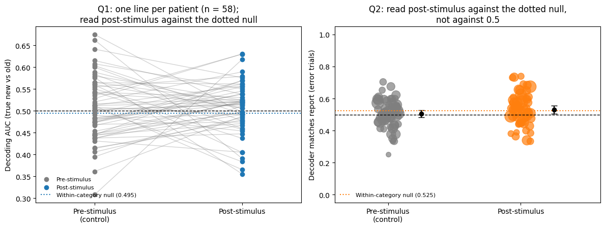

# Recognition memory in human single neurons

When a person misjudges whether they have seen an image before, do neurons in the medial temporal lobe follow the image's true status or the person's judgment? This repository re-analyses public single-neuron recordings from 58 patients ([DANDI:000004](https://dandiarchive.org/dandiset/000004); Chandravadia et al., 2020) to ask that question.

> The data are public and de-identified. They are streamed from DANDI when the notebooks run, and none are stored here. The recordings come from patients with epilepsy undergoing intracranial monitoring.

## Questions

- **Q1 · Replication.** Does spiking 0.05–0.85 s after an image appears decode whether the image is old (seen during learning) or new?
- **Q2 · Reported vs true.** On trials where the patient answered wrongly, does neural activity look like what the patient reported, or like the image's true status?

The analysis plan was written before the data were analysed. Every change made afterwards, and why, is listed at the top of notebook 03.

## Results

85 sessions from 58 patients. Two sessions were skipped because they had fewer than 3 neurons. Decoders are fitted within each session, and patients are the unit of inference.

| | Observed | Within-category null | Excess over the null |
|---|---:|---:|---:|
| **Q1** · decoding AUC | 0.506 (p = .22 vs 0.5) | 0.495 | +0.011 [−0.004, 0.026], p = .047 |
| **Q2** · agreement with the report on errors | 0.531 (p = .030 vs 0.5) | 0.525 | +0.006 [−0.017, 0.029], p = .70 |

- **Neither question has a positive answer.** Q2's nominal result is explained by image category (see below). Q1's excess over the null is borderline: the Wilcoxon test crosses .05, but the bootstrap interval includes zero, and the comparison was added after the results were seen.
- **The likeliest reason is an insensitive pipeline, not absent signal.** This is an inference, not something tested here. The decoder pools every recorded neuron, uses one short window and is not tuned, with about 100 trials per session. Earlier work with this task reports memory-selective neurons in these brain regions (Rutishauser et al., 2015).
- **Q2 is sensitive to analysis choices.** Before the category control, its p-value ranged from .030 to .097 across four reasonable versions of the analysis.



## Problems found in the data and the methods

1. **The truth label is documented backwards.** The files describe `new_old_labels_recog` as 0 = old and 1 = new. In the data, it is 1 for exactly the recognition images that were shown during learning. Read as documented, patients' accuracy came out below chance. The notebooks read 1 = old and check it against the images in every session.
2. **Eight files are missing learning trials.** Seven contain 50 of the 100 learning trials and one contains 97. In these files, true status cannot be fully recovered from the images, so the stored label is the primary truth and both alternatives are reported.
3. **Image category can move both tests without any memory signal.** All 85 sessions balance old and new images within each image category, and neurons in these regions respond to category.
   - *Q2:* if patients call some categories "old" more often, a decoder trained on correct trials learns category. In simulations with no memory signal, agreement was 0.547 (p = .003). The planned pre-stimulus control cannot detect this.
   - *Q1:* with old and new balanced within each category, a category imbalance in the training folds forces the opposite imbalance in the test fold, so a decoder that uses category scores below chance. In simulations with no memory signal, AUC was 0.462, against 0.508 without the balance.
   - *Control:* compare each test with a null in which neural activity is shuffled among trials of the same category. In the simulations, the excess over this null was +0.005 for Q2 and +0.006 for Q1, both indistinguishable from zero. In the real data, the null sits at 0.495 for Q1 (p = .002 vs 0.5) and 0.525 for Q2.

The same balance explains why the category-only model in notebook 02 scores below chance.

## What this does not show

- That these neurons carry no information about memory or the judgment. A more sensitive analysis may find it.
- Any mechanism. A decoder's behaviour on error trials shows which signal its weights align with, not how the brain makes the judgment.
- That the results generalize beyond patients with epilepsy, or beyond this task.

## Contents

| File | Contents |
|---|---|
| [`notebooks/02_Human_Recognition_Neural_Decoding.ipynb`](notebooks/02_Human_Recognition_Neural_Decoding.ipynb) | One session (25 held-out trials). Post-stimulus AUC 0.66 against a within-category null of 0.497, p = .098. |
| [`notebooks/03_Recognition_Across_Sessions.ipynb`](notebooks/03_Recognition_Across_Sessions.ipynb) | All sessions: analysis plan and changes, coding checks, primary tests, sensitivity analyses, category controls. |
| `tests/test_02_synthetic.py` | Runs notebook 02's cells on a synthetic session with a planted memory signal. |
| `tests/test_03_synthetic.py` | Runs notebook 03 on synthetic patients whose neurons follow the report or the truth. |
| `tests/test_03_category_confound.py` | The Q2 category simulation: the raw metric is fooled, the null-corrected one is not. |
| `tests/test_03_category_balance.py` | The Q1 category-balance simulation, with the same check. |

## Reproduce

**Notebooks:** open either notebook in [Google Colab](https://colab.research.google.com/) and choose **Runtime → Run all**. Notebook 03 took about 12 minutes on a standard runtime: about half to stream the files and half for the category shuffles.

**Tests** (synthetic data only, no download needed):

```bash
pip install -r requirements.txt
python tests/test_02_synthetic.py
python tests/test_03_synthetic.py
python tests/test_03_category_confound.py
python tests/test_03_category_balance.py
```

The tests execute the notebooks' own code cells, so they check the published code itself rather than a copy.

## Next step

Split the patients in half. Choose the time window and which neurons to use on one half, then test once on the other, with the within-category null as the primary comparison. The cost is power: about 29 patients per half.

## How this was made

I built the original single-session analysis (notebook 02). I used Claude (Anthropic), an AI model, to debug it, to extend it across all sessions (notebook 03) and to write the tests. The research questions and interpretation are my responsibility. If you find an error, please open an issue.

## References

- Chandravadia, N., et al. (2020). A NWB-based dataset and processing pipeline of human single-neuron activity during a declarative memory task. *Scientific Data*, 7, 78. https://doi.org/10.1038/s41597-020-0415-9
- Rutishauser, U., et al. (2015). Representation of retrieval confidence by single neurons in the human medial temporal lobe. *Nature Neuroscience*. https://doi.org/10.1038/nn.4041

## License

Code: MIT (see `LICENSE`). Text and results: CC BY 4.0. The recordings remain under the license listed for DANDI:000004.
